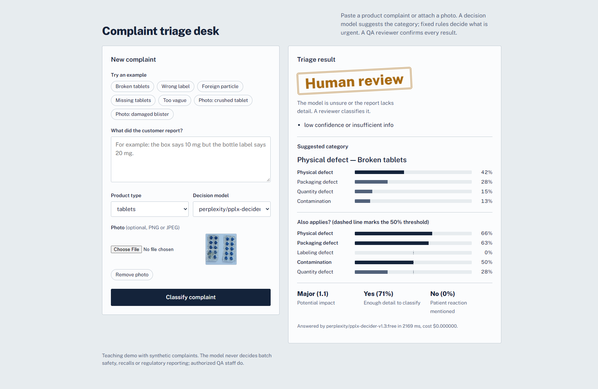
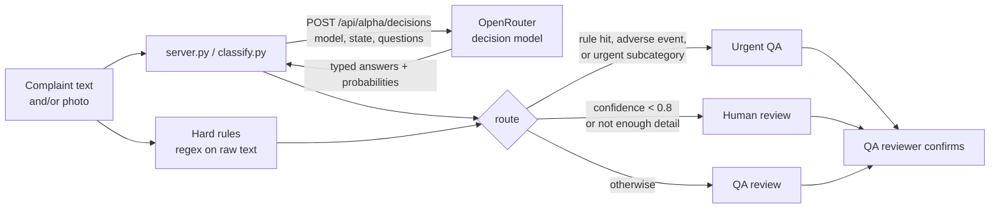

# Pharmaceutical complaint triage with decision models

A small, runnable tutorial that classifies pharmaceutical product complaints (broken tablets, leaking bottles, wrong labels, foreign particles, missing tablets) with **decision models** on OpenRouter — models that return typed answers and probabilities instead of text, such as TypeSafe Jev.

The model suggests a category. Fixed rules decide what is urgent. A QA reviewer confirms every result. The model never decides batch safety, recalls or regulatory reporting.



## Quick start

Requires Python 3.10+ (standard library only, nothing to install) and an [OpenRouter](https://openrouter.ai) key.

```bash
export OPENROUTER_API_KEY=sk-or-v1-...

python classify.py --selftest                 # offline checks, no key needed
python classify.py complaints.json            # benchmark 40 synthetic complaints
JEV_MODEL=liquid/d1 python classify.py complaints.json   # any decision model
python image_test.py images/*.jpg             # photos through 6 models
python server.py                              # web demo on http://127.0.0.1:8765
```

## Architecture



**One request per complaint** asks ten bounded questions:

| Question | Type | Purpose |
|---|---|---|
| `primary_category` | `choice` | physical / packaging / labeling / contamination / quantity / other |
| `subcategory` | `choice` | 19 subcategories + other (broken tablets, wrong strength, foreign particle, …) |
| `tag_<category>` × 5 | `noul` (P(yes)) | multi-label: a complaint can be physical **and** packaging |
| `sufficient_info` | `noul` | enough detail to start classification? |
| `adverse_event` | `noul` | does the complaint mention a patient reaction? |
| `severity` | `score` | Minor / Major / Critical |

**Routing is deterministic code** (`route()` in `classify.py`):

1. Hard rules on the raw text: conflicting mg/ml/mcg values, contamination words (particle, hair, glass, mold…), adverse-event words (rash, vomit, swelling…), broken or tampered seal.
2. Model signals: adverse event ≥ 0.5, or an urgent subcategory (wrong strength, foreign particle, microbial, wrong pack, broken seal).
3. Any hit from 1 or 2 → **Urgent QA**. The model can add urgency but never cancel a rule hit.
4. Primary-category confidence < 0.8 or insufficient info → **Human review**. Otherwise → **QA review**.

**Web demo**: `server.py` (stdlib `http.server`, bound to `127.0.0.1`) serves `index.html` and proxies `/api/classify` to OpenRouter, so the API key never reaches the browser. Default model is Perplexity Decider v1.3 with automatic fallback to Jev 1.14.

## Benchmark results

Run 2026-11-14 on `complaints.json`: 40 synthetic complaints, 12 of them urgent, with mixed-defect, vague and non-quality cases. Same questions and rules for every model. Raw responses are in [`benchmarks/`](benchmarks/).

| Model | Primary category | Subcategory | Enough-info | Urgent recall | Human-review routes | Cost / 1,000 |
|---|---|---|---|---|---|---|
| **perplexity/pplx-decider-v1.3:free** | **100%** | **95%** | 97.5% | 12/12 | 8 | **$0** |
| typesafe/jev-1.14 | 100% | 92.5% | 100% | 12/12 | 7 | $0.052 |
| liquid/d1 | 97.5% | 90% | 97.5% | 12/12 | 9 | $0.014 |
| openai/gpt-6-luna-decisions | 95% | 95% | 97.5% | 12/12 | 5 | $0.191 |
| google/gemini-decision-1 | 90% | 95% | 97.5% | 12/12 | 8 | $0.108 |
| cloudflare/clef-flash | 87.5% | 85% | 95% | 12/12 | 22 | $0.037 |

Urgent precision was 12/12 for every model. Every run of 40 complaints finished in 6–8 seconds with 8 parallel workers.

**Multi-label tag precision / recall at a 0.5 threshold:**

| Model | physical | packaging | labeling | contamination | quantity |
|---|---|---|---|---|---|
| perplexity decider v1.3 | 76 / 93 | 56 / 91 | 100 / 100 | 78 / 100 | 86 / 100 |
| jev-1.14 | 68 / 93 | 53 / 91 | 100 / 100 | 35 / 100 | 67 / 100 |
| liquid/d1 | 70 / 100 | 58 / 100 | 100 / 88 | 41 / 100 | 75 / 100 |
| gpt-6-luna-decisions | 65 / 93 | 53 / 91 | 100 / 100 | 54 / 100 | 67 / 100 |
| gemini-decision-1 | 68 / 93 | 59 / 91 | 100 / 100 | 44 / 100 | 67 / 100 |
| clef-flash | 78 / 100 | 79 / 100 | 100 / 88 | 100 / 100 | 100 / 100 |

The single-answer `choice` questions are strong. The yes/no tags over-fire at 0.5 (e.g. "10 mg vs 20 mg" tagged as a quantity problem); tune a threshold per tag on a larger labeled set.

On the 40 complaints, the hard rules alone caught 11/12 urgent cases and Jev alone caught 11/12 — different misses, so running both caught all 12.

**Photo only, no text** (`image_test.py`, 2 photos):

| Photo | Result |
|---|---|
| Crushed tablet next to a blister | All 6 models: physical defect / broken tablets (confidence 0.59–0.90) |
| Discolored tablets under a damaged, stained blister | Models split on the primary category; every confidence ≤ 0.63, so it routes to Human review. Most tag physical + packaging + contamination. |

Photo requests cost 4–8× a text request.

## Files

| Path | What it is |
|---|---|
| `classify.py` | Questions, hard rules, routing, OpenRouter client with retries, benchmark metrics, `--selftest` |
| `complaints.json` | 40 synthetic complaints with reference labels |
| `image_test.py` | Sends photos to six decision models and prints answers side by side |
| `server.py`, `index.html` | Local web demo |
| `benchmarks/` | Raw model responses from the benchmark runs |
| `images/` | Two example complaint photos |
| `report.md` | Research notes: what Jev is, API contract, related use cases, prior art, sources |

## Limitations

- 40 short, mostly clear synthetic complaints labeled by their author. Real complaints are messier; expect lower numbers. The model ranking is a hint, not a conclusion.
- The hard rules are keyword patterns tuned on this set; they will miss some wordings and over-flag others.
- Free-tier rate limits and data-use terms of the Perplexity model, and TypeSafe's terms for regulated (GxP) use, were not checked. Do not send real patient or company data until they are.
- The taxonomy is illustrative, not an industry standard. Escalation and reporting requirements depend on each company's approved procedures and applicable regulations.
- Example photos come from the web and are used for testing only.
